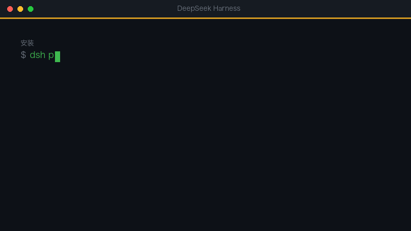

# dsh-inspiration-vault（灵感库）

> 一个只属于你的本地灵感库，跑在 DSH 里。

> 🐧 **AI 学习群 1132348296** · niko 在这儿，插件我写、方向我找、坑我踩。 灵感怎么变成插件、怎么找到没人做的方向，群里每周聊。



## 三大亮点

1. **一句话记，三个词找回来** —— 看到什么随手记一行，之后搜关键词就能翻出来，中英文都行。
2. **只记录，不评判** —— 不总结、不评分、不擅自生成待办；卡片是纯 Markdown，能读、能搜、能 git。
3. **零依赖、不联网** —— 没有数据库、没有 API key、没有导出按钮，断网也能记。

---

## 这是什么

白天你看到点东西——竞品的产品、值得抄的账号、对某个市场的一闪而过的直觉。你敲一行字，它存下来。过几天，敲三个关键词，它又回来了。

就这么简单。

```text
/idea 看到有人在小红书卖 Excel 模板，一个月卖了两万多
→ 已记下 · i-20261111-001 · 灵感
  「看到有人在小红书卖 Excel 模板，一个月卖了两万多」
  标签：小红书

/ideas 模板
→ 搜到 1 条（模板）：
  1. 看到有人在小红书卖 Excel 模板，一个月卖了两万多
     灵感 · i-20261111-001
```

## 为什么是这一个

大多数「AI 笔记应用」都在回答你没问的问题：帮你总结、给你打分、告诉你下一步该做什么，悄悄把一个一闪而过的念头，变成你从没答应过的待办。

这个不会。

- **只记录，不评判。** 不下结论、不判断「重要性」、不主动给建议。想要意见，你开口问。
- **从不生成待办。** 笔记就是笔记。`next` 永远是空的，除非你自己写。
- **纯文件。** 每条笔记一张 Markdown 卡片，存在 `~/.dsh/inspiration-vault/cards/`。能读、能 grep、能改、能进 git。没有数据库，没有导出按钮，不锁定你。
- **零依赖。** 没有 npm 包、没有网络请求、没有 API key。
- **离线可用。** 什么都不会离开你的电脑。

## 安装

在 DSH 应用里：设置 → 插件 → 安装 `dsh-inspiration-vault`。

或者从源码装：

```bash
git clone https://github.com/nekonya77/dsh-inspiration-vault.git
cd dsh-inspiration-vault
dsh plugin install .
```

## 命令

| 命令 | 作用 |
| --- | --- |
| `/idea <内容>` | 记一条。链接、多行、任何东西都行。 |
| `/idea --opportunity <内容>` | 同上，但指定类型（`idea` · `opportunity` · `observation` · `reference` · `todo`）。 |
| `/ideas` | 最近 8 条。 |
| `/ideas <关键词>` | 加权搜索：标题 ×6、标签 ×5、正文 ×2，中英文都行。 |
| `/ideas <id>` | 打开一条的全文。`006` 就够了，不用输日期。 |

## 卡片格式

```yaml
---
id: i-20261111-001
title: 看到有人在小红书卖 Excel 模板，一个月卖了两万多
type: idea            # idea | opportunity | observation | reference | todo
status: seed          # seed | exploring | doing | done | dropped | archived
tags: [小红书, 模板, 变现]
next:                 # 故意留空——只有你决定行动时才填
source: https://www.xiaohongshu.com/...
created: 2026-11-11T14:02:11+08:00
updated: 2026-11-11T14:02:11+08:00
---
看到有人在小红书卖 Excel 模板，一个月卖了两万多，链接：https://...
```

frontmatter 之后就是你自己的原文，一个字都不改。

## 配置

默认存在 `~/.dsh/inspiration-vault`。想换目录（比如放进同步盘），在插件配置里写：

```yaml
vaultDir: ~/Dropbox/inspiration
```

或者在启动 DSH 前设置环境变量 `DSH_INSPIRATION_DIR`。

## 可选：让助手读这个库

`skill/SKILL.md` 是一个现成技能，告诉 agent 在回答之前**什么时候**该先搜这个库（营销方案、内容选题、增长点子、「我是不是写过类似的」）。复制进去即可：

```bash
mkdir -p ~/.agents/skills/inspiration-vault
cp skill/SKILL.md ~/.agents/skills/inspiration-vault/SKILL.md
```

## 路线图

- [ ] `/ideas due` —— 只看你自己设了日期的卡片
- [ ] 标签索引页
- [ ] 可定时的每日回顾（只做摘要，需手动开启）

明确不做：自动打分、自动待办、你没要过的「AI 建议」。

## 许可

MIT © clairliu
